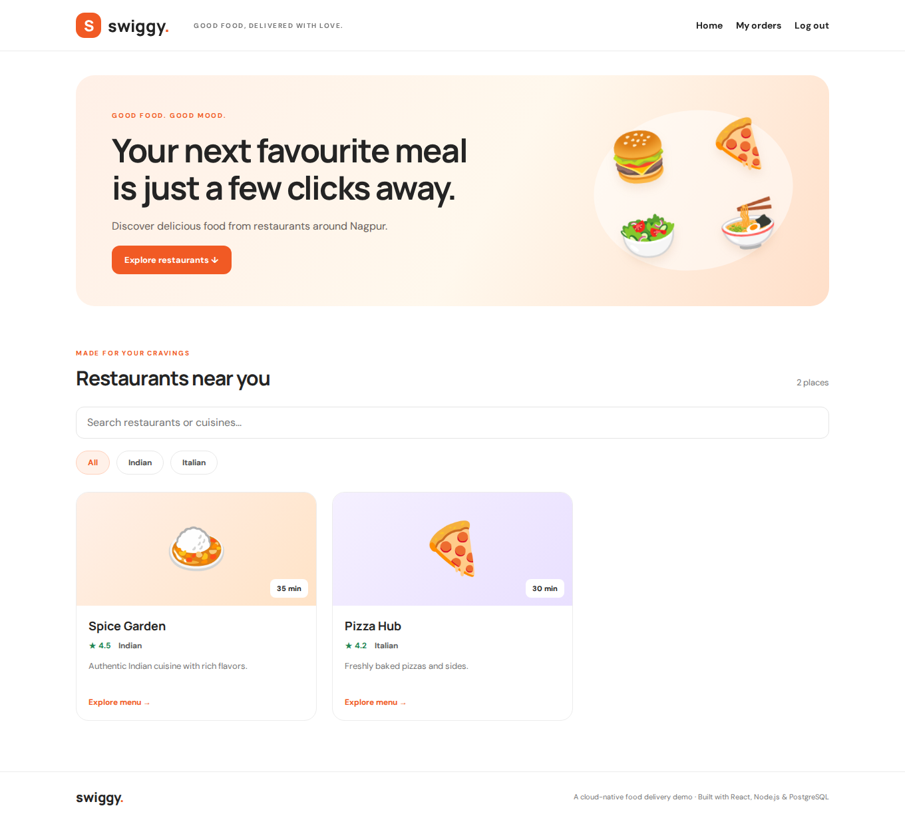
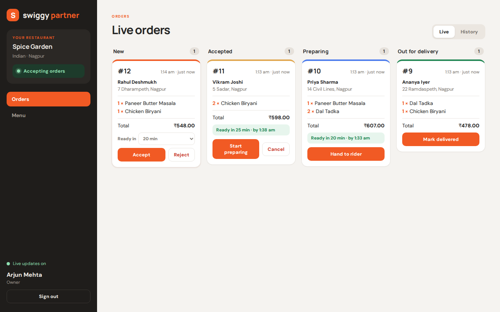
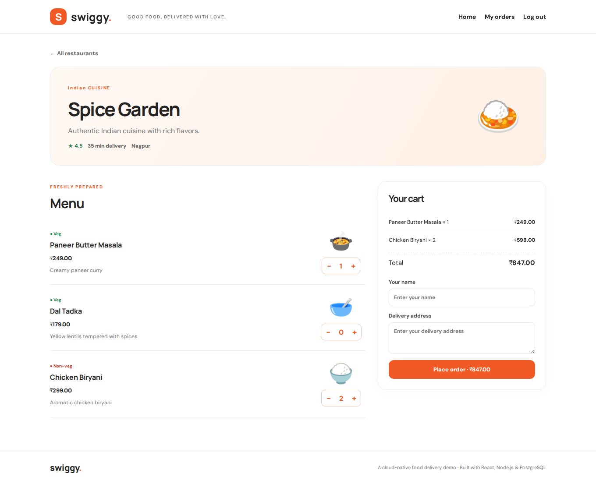
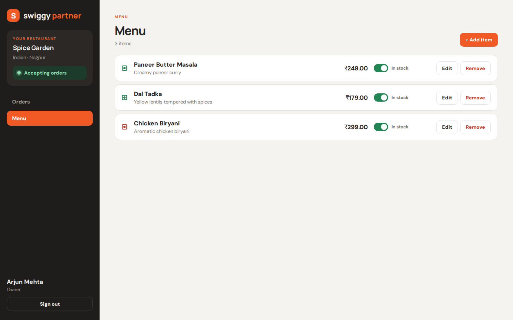
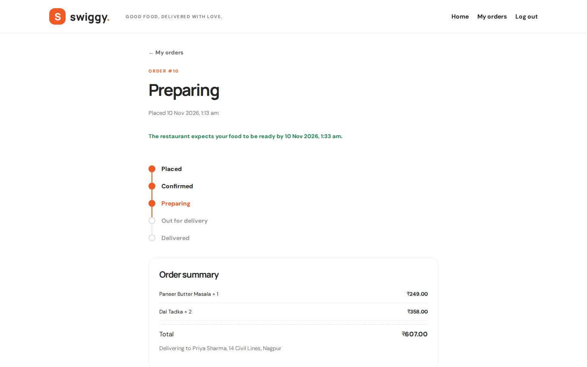
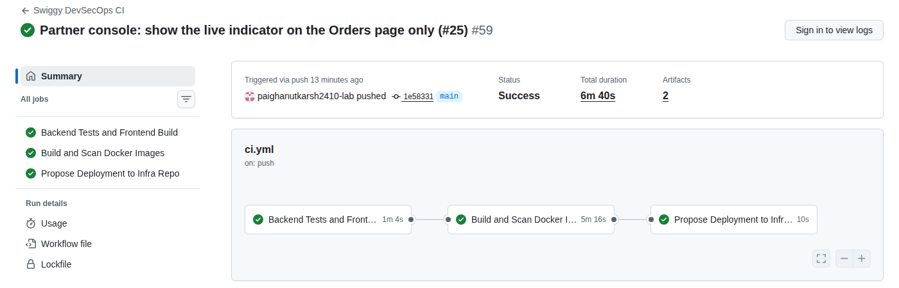
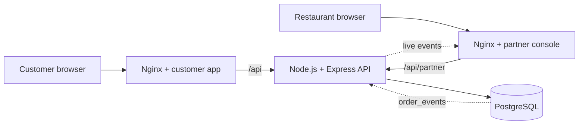

# Swiggy DevSecOps App

[](https://github.com/paighanutkarsh2410-lab/swiggy-devsecops-app/actions/workflows/ci.yml)
[](https://github.com/paighanutkarsh2410-lab/swiggy-devsecops-app/actions/workflows/codeql.yml)


A food delivery app, with a customer website and a restaurant partner console, used as the workload for an end-to-end DevSecOps project. The app is deliberately small; the focus is on how code is tested, scanned, signed and delivered.

Its Kubernetes, GitOps and cloud side lives in [swiggy-devsecops-infra](https://github.com/paighanutkarsh2410-lab/swiggy-devsecops-infra).

This is a personal learning project and is not affiliated with Swiggy.

## Highlights

- **Two real websites on one API:** customers order and track; restaurants accept orders, set preparation times and manage the menu. Every role is enforced on the server.
- **Live orders:** PostgreSQL `LISTEN/NOTIFY` and Server-Sent Events push new orders to the partner console, across any number of API replicas.
- **Security gates in CI:** Trivy (code and images), CodeQL, backend tests and an OWASP ZAP scan of the running app must all pass before anything is published.
- **Supply chain:** each image gets a CycloneDX SBOM, is signed keylessly with cosign, and is deployed by sha256 digest. The infra repo refuses unsigned images.
- **GitOps delivery:** CI never deploys. It opens a pull request in the infra repo, and merging it is the deployment, through Argo CD.

## Screenshots

Taken from the app running on a local kind cluster, deployed by Argo CD.

| Customer app | Partner console |
|---|---|
|  |  |
| **Restaurants**, with search and cuisine filters | **Live orders**: new orders arrive without a reload; accept with a preparation time and move them along |
|  |  |
| **Menu and cart** | **Menu management**: owners add, edit and remove items; staff mark them sold out |
|  |  |
| **Order tracking**, with the restaurant's ready-by time | **CI pipeline** on `main`: tests, scans, ZAP, SBOMs, signing and the deploy pull request |

## Repository layout

| Path | Contents |
|---|---|
| `backend/` | Express API, database schema and migrations, tests |
| `frontend/` | Customer app (React + Vite), served by Nginx |
| `frontend-partner/` | Partner console (React + Vite), served by Nginx |
| `docker-compose.yml` | The whole stack for local development |
| `.github/workflows/` | CI (`ci.yml`) and CodeQL |
| `.github/scripts/` | The ZAP scan and the infra deploy pull request |
| `.github/dast/rules.tsv` | ZAP alerts that are accepted, each with its reason |

## Architecture

There are two separate websites, built and deployed as separate images, sharing one API:

- **Customer app** (`frontend`): browse restaurants, order, and track orders.
- **Partner console** (`frontend-partner`): restaurant owners and staff accept or reject orders, set preparation times, move orders along, mark items sold out, edit the menu, and open or close the restaurant.



The API enforces every role on the server: a customer token gets `403` from partner routes whatever the browser shows, and partners only ever see their own restaurant.

New orders reach the partner console live. A database trigger publishes each new order and status change with PostgreSQL `NOTIFY`, every API instance `LISTEN`s, and each one streams its restaurant's events to connected consoles over Server-Sent Events. This works with more than one API replica, because events go through the database rather than one process's memory.

## CI/CD pipeline

```mermaid
flowchart LR
    Push[git push] --> Scan[Trivy repo scan]
    Scan --> Test[Backend tests]
    Test --> Build[Lint and build both frontends]
    Build --> Images[Build 3 Docker images]
    Images --> ImageScan[Trivy image scans]
    ImageScan --> ZAP[OWASP ZAP scan of the running app]
    ZAP --> SBOM[Syft SBOMs]
    SBOM --> GHCR[Publish to GHCR]
    GHCR --> Sign[cosign: sign + attest SBOM]
    Sign --> InfraPR[Open deploy PR pinned by digest]
    InfraPR --> Verify[Infra CI verifies signatures]
    Verify --> Argo[Merged: Argo CD deploys]
```



Trivy fails the build on any fixable HIGH or CRITICAL finding, and images are only published from `main` after every scan passes. CodeQL analyses the code on each pull request, and Dependabot opens weekly update pull requests.

### Supply-chain security

- **Dynamic scan (DAST).** Before anything is published, `.github/scripts/dast.sh` starts the freshly built images with Docker Compose and runs the [OWASP ZAP](https://www.zaproxy.org/) baseline scan against both websites, crawling the JavaScript pages too. Any alert not explained in [`.github/dast/rules.tsv`](.github/dast/rules.tsv) fails the build; the HTML and JSON reports are kept as the `zap-reports` artifact of each run. Its first run found no Content Security Policy, missing clickjacking and cross-origin headers and the Nginx version in responses. Both sites now send a strict same-origin CSP and the other headers from `security-headers.conf`, with fonts bundled instead of loaded from Google.
- **SBOMs.** [Syft](https://github.com/anchore/syft) lists every package in each image as a CycloneDX SBOM, kept as the `sboms` artifact of every run.
- **Signed images.** On `main`, each image is signed by digest with [cosign](https://github.com/sigstore/cosign) keyless signing: GitHub's OIDC token gets a short-lived certificate from Sigstore that names this repository's `ci.yml` workflow on `main`, and the signature is recorded in Sigstore's public transparency log. Each image's SBOM is attached as a signed attestation. There are no signing keys to store or leak.
- **Deploy by digest.** The deploy pull request pins each image's sha256 digest, and the infra repo's CI refuses images that are not signed by this workflow on `main`.
- **Pinned actions.** Every GitHub Action is pinned to a full commit SHA, so a moved or compromised tag cannot change what CI runs. Dependabot updates the pins.

Check an image yourself (needs cosign):

```bash
cosign verify \
  --certificate-identity https://github.com/paighanutkarsh2410-lab/swiggy-devsecops-app/.github/workflows/ci.yml@refs/heads/main \
  --certificate-oidc-issuer https://token.actions.githubusercontent.com \
  ghcr.io/paighanutkarsh2410-lab/swiggy-devsecops-backend:<commit-sha>
```

`cosign verify-attestation --type cyclonedx` with the same flags checks the SBOM attestation and prints it.

Known limitation: both websites keep the login token in `localStorage`, where an XSS bug could read it. The strict CSP makes that much harder, and moving the token to an HttpOnly cookie is the planned fix.

### Deployment (GitOps)

This repo never deploys anything itself. After the images are published and signed, CI opens a pull request in [swiggy-devsecops-infra](https://github.com/paighanutkarsh2410-lab/swiggy-devsecops-infra) that sets the new image tag and digests. Merging that pull request is the deployment: Argo CD rolls it out to the Kubernetes cluster, and reverting it rolls back. See the infra repo's README for the full flow.

The job needs a token that can open pull requests in the infra repo. Without it the job does nothing and says so. To set it up:

1. In GitHub, go to **Settings → Developer settings → Personal access tokens → Fine-grained tokens → Generate new token**.
2. Give it access to **only** `swiggy-devsecops-infra`, with **Contents: Read and write** and **Pull requests: Read and write**. Set an expiry date.
3. In this repo, go to **Settings → Secrets and variables → Actions → New repository secret**, name it `INFRA_REPO_TOKEN` and paste the token.

| Image | Contents |
|---|---|
| `ghcr.io/paighanutkarsh2410-lab/swiggy-devsecops-backend` | Express API |
| `ghcr.io/paighanutkarsh2410-lab/swiggy-devsecops-frontend` | Customer app on Nginx |
| `ghcr.io/paighanutkarsh2410-lab/swiggy-devsecops-partner` | Partner console on Nginx |

## Tech stack

| Area | Tools |
|---|---|
| Frontends | React, Vite, React Router, Nginx |
| Backend | Node.js, Express, PostgreSQL (LISTEN/NOTIFY), Server-Sent Events |
| Containers | Docker, Docker Compose, GHCR |
| CI and security | GitHub Actions, Trivy, CodeQL, Dependabot, OWASP ZAP, Syft, cosign (Sigstore) |

## Run it locally

You need Docker with the Compose plugin.

```bash
git clone https://github.com/paighanutkarsh2410-lab/swiggy-devsecops-app.git
cd swiggy-devsecops-app
cp .env.example .env
```

Set your own `DB_PASSWORD` and `JWT_SECRET` in `.env`. `JWT_SECRET` must be at least 32 characters, and `openssl rand -hex 32` makes a good one. Then start the stack:

```bash
docker compose up -d --build
```

| Service | URL |
|---|---|
| Customer app | http://localhost:8080 |
| Partner console | http://localhost:8082 |
| API | http://localhost:8080/api/restaurants |
| API health | http://localhost:3000/health |
| Database health | http://localhost:3000/health/db |

The API port is bound to `127.0.0.1`, so from other machines the API is only reachable through Nginx.

## Accounts

Customers register on the customer app. Partner accounts are created from the command line, so nobody can sign up as a restaurant:

```bash
docker exec \
  -e STAFF_NAME="Spice Garden Owner" \
  -e STAFF_EMAIL="owner@example.com" \
  -e STAFF_PASSWORD="choose-a-password" \
  -e STAFF_RESTAURANT_ID=1 \
  -e STAFF_ROLE=OWNER \
  swiggy-backend node src/scripts/createStaff.js
```

Leave out `STAFF_ROLE` to create a `STAFF` account.

| Role | Partner console can |
|---|---|
| `OWNER` | Everything: orders, open or close, add, edit and remove menu items |
| `STAFF` | Handle orders, open or close, mark items sold out or back in stock |

A database created before these features needs the migrations, in order. Both are safe to run more than once:

```bash
docker exec -i swiggy-postgres psql -U swiggy_app -d swiggy_db < backend/db/migrations/001_add_users.sql
docker exec -i swiggy-postgres psql -U swiggy_app -d swiggy_db < backend/db/migrations/002_partner_console.sql
```

## Run the tests

The backend tests need a running PostgreSQL database loaded with `backend/db/init.sql`. Set the variables from `backend/.env.example`, then run:

```bash
npm ci --prefix backend
npm test --prefix backend
```

## API

### Customer and public

| Method | Path | Access | Purpose |
|---|---|---|---|
| GET | `/api/restaurants` | Public | List active restaurants, with whether each is open |
| GET | `/api/restaurants/:id` | Public | Get one restaurant |
| GET | `/api/restaurants/:id/menu` | Public | Get the items customers can order |
| POST | `/api/auth/register` | Public | Create a customer account |
| POST | `/api/auth/login` | Public | Log in |
| GET | `/api/auth/me` | Logged in | Get the current user |
| GET | `/api/orders` | Logged in | List your orders |
| POST | `/api/orders` | Logged in | Place an order (refused while the restaurant is closed) |
| GET | `/api/orders/:id` | Order's customer or restaurant | Get an order |
| PATCH | `/api/orders/:id/status` | Order's customer | Cancel while the order is `PLACED` |

### Partner console

All partner routes need an `OWNER` or `STAFF` login and only touch that partner's restaurant.

| Method | Path | Access | Purpose |
|---|---|---|---|
| GET | `/api/partner/me` | Partner | Current partner and their restaurant |
| PATCH | `/api/partner/restaurant` | Partner | Open or close for new orders |
| GET | `/api/partner/orders` | Partner | Active orders, or `?scope=all` for history |
| PATCH | `/api/partner/orders/:id/status` | Partner | Accept with `prep_minutes`, reject, or move along |
| GET | `/api/partner/events` | Partner | Live order events (Server-Sent Events) |
| GET | `/api/partner/menu` | Partner | Full menu, including sold-out items |
| POST | `/api/partner/menu` | Owner | Add an item |
| PATCH | `/api/partner/menu/:id` | Owner; staff for `is_available` only | Edit an item or mark it sold out |
| DELETE | `/api/partner/menu/:id` | Owner | Remove an item (archived, so past orders keep it) |

Orders move through `PLACED`, `CONFIRMED`, `PREPARING`, `OUT_FOR_DELIVERY` and `DELIVERED`. The restaurant can reject an order until preparation starts, and customers can cancel while it is `PLACED`.

## Metrics

The API serves Prometheus metrics at `GET /metrics` on port 3000. The path is outside `/api`, so neither website's Nginx proxies it: on Kubernetes only Prometheus can reach it, through a network policy. The infra repo's Grafana dashboard and alerts are built on these:

| Metric | Type | What it measures |
|---|---|---|
| `swiggy_http_request_duration_seconds` | Histogram | Request time by `method`, `route` and `status_code`. Routes are patterns such as `/api/orders/:id`, never raw URLs, so the number of series stays small |
| `swiggy_orders_created_total` | Counter | Orders placed, by `restaurant_id` |
| `swiggy_order_status_changes_total` | Counter | Status changes, by new `status` and `actor` (`customer` or `partner`) |
| `swiggy_partner_event_streams` | Gauge | Partner consoles connected to the live order stream |
| `swiggy_process_*`, `swiggy_nodejs_*` | Various | CPU, memory, event loop lag and garbage collection |

Every metric carries `app="swiggy-backend"`.

## Design decisions

| Decision | Why |
|---|---|
| Server-Sent Events, not WebSockets, for live orders | Updates only flow from server to browser. SSE is plain HTTP, works through Nginx with buffering off, and reconnects simply. |
| PostgreSQL `LISTEN/NOTIFY` between API replicas | The database already sees every order, so no extra message broker is needed, and events reach every replica. |
| Separate images for the two websites | They can be released, scaled and locked down independently; the partner console sends `X-Robots-Tag` and a stricter referrer policy. |
| Bearer token in `localStorage` | Simple and explicit. The trade-off is that an XSS bug could read it, so XSS is defended in depth: strict same-origin CSP with no inline scripts, React escaping and no raw HTML, CodeQL and ZAP in CI, 8-hour tokens. HttpOnly cookies would trade that for CSRF handling and, with both sites on one host, separate cookies per site. |
| Keyless signing instead of a signing key | Nothing secret to store or rotate. The signature proves which workflow, branch and commit built the image, and is publicly logged. |
| Deploy by digest, keep the tag | The digest guarantees the exact bytes that were scanned and signed; the commit SHA tag keeps it readable. |

## Project status

- [x] React frontend, Express API and PostgreSQL
- [x] Docker images and Docker Compose
- [x] GitHub Actions CI with tests, lint and build
- [x] Blocking Trivy scans and GHCR publishing
- [x] CodeQL, Dependabot and branch protection
- [x] Login, order access control and order tracking
- [x] Separate partner console with live orders and menu management
- [x] Kubernetes deployment ([infra repo](https://github.com/paighanutkarsh2410-lab/swiggy-devsecops-infra))
- [x] Ansible and Terraform automation
- [x] AWS deployment on K3s
- [x] GitOps with Helm and Argo CD
- [x] Monitoring with Prometheus and Grafana ([on kind](https://github.com/paighanutkarsh2410-lab/swiggy-devsecops-infra#monitoring), on demand)
- [x] Supply-chain security: SBOMs, signed images deployed by digest, OWASP ZAP, pinned actions
