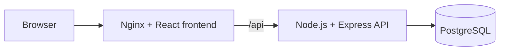
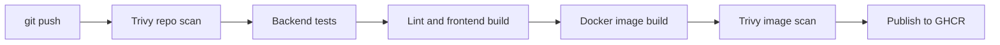

# Swiggy DevSecOps App

A food delivery demo used as the workload for an end-to-end DevSecOps project. The app itself is deliberately small. The focus is on how code is tested, scanned, packaged and delivered.

This is a personal learning project and is not affiliated with Swiggy.

## Architecture



## CI/CD pipeline



Trivy fails the build on any fixable HIGH or CRITICAL finding, and images are only published from `main` after every scan passes. CodeQL analyses the code on each pull request, and Dependabot opens weekly update pull requests.

## Tech stack

| Area | Tools |
|---|---|
| Frontend | React, Vite, React Router, Nginx |
| Backend | Node.js, Express, PostgreSQL |
| Containers | Docker, Docker Compose, GHCR |
| CI and security | GitHub Actions, Trivy, CodeQL, Dependabot |

## Run it locally

You need Docker with the Compose plugin.

```bash
git clone https://github.com/paighanutkarsh2410-lab/swiggy-devsecops-app.git
cd swiggy-devsecops-app
cp .env.example .env
```

Set your own `DB_PASSWORD` in `.env`, then start the stack:

```bash
docker compose up -d --build
```

| Service | URL |
|---|---|
| Website | http://localhost:8080 |
| API | http://localhost:8080/api/restaurants |
| API health | http://localhost:3000/health |
| Database health | http://localhost:3000/health/db |

## Run the tests

The backend tests need a running PostgreSQL database loaded with `backend/db/init.sql`. Set the variables from `backend/.env.example`, then run:

```bash
npm ci --prefix backend
npm test --prefix backend
```

## API

| Method | Path | Purpose |
|---|---|---|
| GET | `/api/restaurants` | List active restaurants |
| GET | `/api/restaurants/:id` | Get one restaurant |
| GET | `/api/restaurants/:id/menu` | Get a restaurant's menu |
| POST | `/api/orders` | Place an order |
| GET | `/api/orders/:id` | Get an order |
| PATCH | `/api/orders/:id/status` | Update an order's status |

## Project status

- [x] React frontend, Express API and PostgreSQL
- [x] Docker images and Docker Compose
- [x] GitHub Actions CI with tests, lint and build
- [x] Blocking Trivy scans and GHCR publishing
- [x] CodeQL, Dependabot and branch protection
- [ ] Login and order access control
- [ ] Kubernetes deployment
- [ ] Ansible and Terraform automation
- [ ] AWS deployment on K3s
- [ ] GitOps with Helm and Argo CD
- [ ] Monitoring with Prometheus and Grafana
