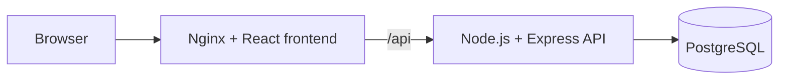
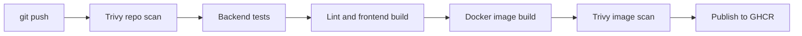

# Swiggy DevSecOps App

A food delivery demo used as the workload for an end-to-end DevSecOps project. The app itself is deliberately small. The focus is on how code is tested, scanned, packaged and delivered.

This is a personal learning project and is not affiliated with Swiggy.

## Architecture



## CI/CD pipeline



Trivy fails the build on any fixable HIGH or CRITICAL finding, and images are only published from `main` after every scan passes. CodeQL analyses the code on each pull request, and Dependabot opens weekly update pull requests.

## Tech stack

| Area | Tools |
|---|---|
| Frontend | React, Vite, React Router, Nginx |
| Backend | Node.js, Express, PostgreSQL |
| Containers | Docker, Docker Compose, GHCR |
| CI and security | GitHub Actions, Trivy, CodeQL, Dependabot |

## Run it locally

You need Docker with the Compose plugin.

```bash
git clone https://github.com/paighanutkarsh2410-lab/swiggy-devsecops-app.git
cd swiggy-devsecops-app
cp .env.example .env
```

Set your own `DB_PASSWORD` and `JWT_SECRET` in `.env`. `JWT_SECRET` must be at least 32 characters, and `openssl rand -hex 32` makes a good one. Then start the stack:

```bash
docker compose up -d --build
```

| Service | URL |
|---|---|
| Website | http://localhost:8080 |
| API | http://localhost:8080/api/restaurants |
| API health | http://localhost:3000/health |
| Database health | http://localhost:3000/health/db |

The API port is bound to `127.0.0.1`, so from other machines the API is only reachable through Nginx.

## Accounts

Customers register on the website. Restaurant staff accounts are created from the command line, so nobody can sign up as staff:

```bash
docker exec \
  -e STAFF_NAME="Spice Garden Staff" \
  -e STAFF_EMAIL="staff@example.com" \
  -e STAFF_PASSWORD="choose-a-password" \
  -e STAFF_RESTAURANT_ID=1 \
  swiggy-backend node src/scripts/createStaff.js
```

If your database was created before accounts existed, apply `backend/db/migrations/001_add_users.sql` first.

## Run the tests

The backend tests need a running PostgreSQL database loaded with `backend/db/init.sql`. Set the variables from `backend/.env.example`, then run:

```bash
npm ci --prefix backend
npm test --prefix backend
```

## API

| Method | Path | Access | Purpose |
|---|---|---|---|
| GET | `/api/restaurants` | Public | List active restaurants |
| GET | `/api/restaurants/:id` | Public | Get one restaurant |
| GET | `/api/restaurants/:id/menu` | Public | Get a restaurant's menu |
| POST | `/api/auth/register` | Public | Create a customer account |
| POST | `/api/auth/login` | Public | Log in |
| GET | `/api/auth/me` | Logged in | Get the current user |
| GET | `/api/orders` | Logged in | List your orders |
| POST | `/api/orders` | Logged in | Place an order |
| GET | `/api/orders/restaurant` | Staff | List your restaurant's orders |
| GET | `/api/orders/:id` | Owner or staff | Get an order |
| PATCH | `/api/orders/:id/status` | Owner or staff | Update an order's status |

Orders move through `PLACED`, `CONFIRMED`, `PREPARING`, `OUT_FOR_DELIVERY` and `DELIVERED`. Staff can reject an order until preparation starts, and customers can cancel while it is `PLACED`.

## Project status

- [x] React frontend, Express API and PostgreSQL
- [x] Docker images and Docker Compose
- [x] GitHub Actions CI with tests, lint and build
- [x] Blocking Trivy scans and GHCR publishing
- [x] CodeQL, Dependabot and branch protection
- [x] Login, order access control and order tracking
- [ ] Kubernetes deployment
- [ ] Ansible and Terraform automation
- [ ] AWS deployment on K3s
- [ ] GitOps with Helm and Argo CD
- [ ] Monitoring with Prometheus and Grafana
